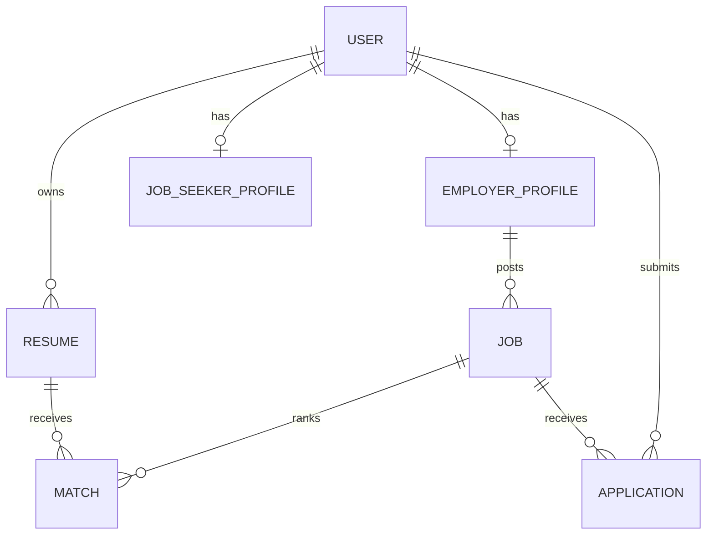

# Initial ERD

The model details are intentionally provisional until product fields and
retention rules are confirmed.

The Django app models are scaffolds; migrations will be generated after the
domain fields and relationships are finalized.
